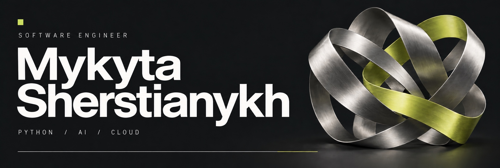

# Python Software Engineer · AI & Cloud

I build production LLM applications and cloud services in Python. Currently a Software Engineer at EPAM Systems; previously at SoftServe, working on AI assistants, RAG pipelines, and cloud integrations.

[LinkedIn](https://www.linkedin.com/in/mykytasherstianykh/) · [Email](mailto:mykyta.sherstianykh@gmail.com) · [Telegram](https://t.me/thoughtseize)

## Engineering focus

- **LLM systems** — AI assistants, RAG pipelines, and agent workflows with LangChain, OpenAI, and Anthropic models.
- **Cloud engineering** — asynchronous Python APIs, microservices, and integrations across AWS and Google Cloud.
- **Reliability & delivery** — LLM evaluation, prompt and pipeline optimization, usage analytics, and automated testing.

[Claude Certified Architect – Foundations](https://verify.skilljar.com/c/7snw64uqqvyx) · Anthropic · May 2026

## Public projects

### [Higgsfield MCP](https://github.com/Thoughtseize1/Claude_higgsfield_mcp)

A Python MCP server connecting Claude Code with Higgsfield image and video generation workflows. Includes job tracking, batch generation, and local output handling.

`Python` `MCP` `AI tooling` `asyncio`

### [Social Network API](https://github.com/Thoughtseize1/social_network_API)

A social API with JWT authentication, posts, likes, and daily activity analytics. A configurable bot exercises the user flows end to end.

`FastAPI` `PostgreSQL` `JWT` `Automation`

### [File System Insight Tool](https://github.com/Thoughtseize1/File_System_Insight_Tool)

A command-line tool for exploring disk usage, grouping files by type, finding large files, and inspecting unusual permissions.

`Python` `CLI` `File systems`

### [gRPC File Exchange](https://github.com/Thoughtseize1/simple_gRPC-server)

A Python client and server for listing and downloading files over gRPC, with configurable paths and hidden-file support.

`Python` `gRPC` `Client–server`

## Toolkit

| Area | Technologies |
| :--- | :--- |
| AI & integration | LangChain · RAG · AI agents · OpenAI · Anthropic · MCP |
| Python & APIs | Python · FastAPI · asyncio · REST · GraphQL · gRPC |
| Data & search | PostgreSQL · SQLAlchemy · MongoDB · Redis · Elasticsearch |
| Cloud | AWS (ECS, Lambda, S3, DynamoDB) · Google Cloud |
| Delivery & quality | Docker · GitHub Actions · Pytest · Git |

---

**Mykyta Sherstianykh** · Kraków, Poland

BSc & MSc in Computer Science · Ukrainian State University of Science and Technologies

Interested in Python, AI tooling, and cloud engineering? [Let's connect on LinkedIn.](https://www.linkedin.com/in/mykytasherstianykh/)
